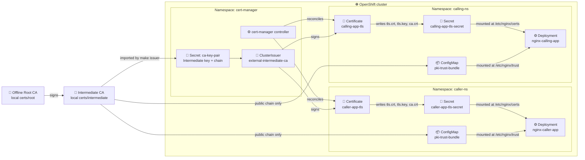
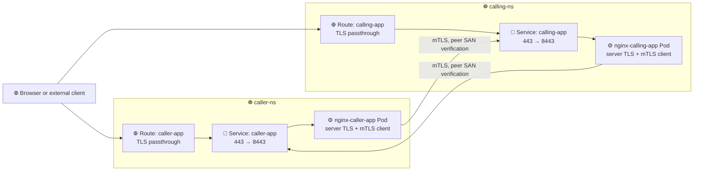
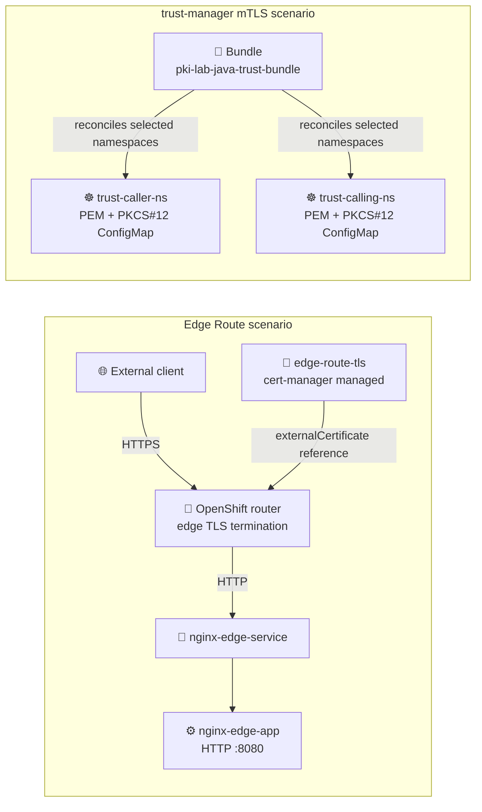

# Architecture

The diagrams describe the resources created by the lab and the reconciliation paths that keep certificates and trust data current. Mermaid renders directly in GitHub and remains aligned with the manifests.

## Base certificate reconciliation

The Root private key never enters the cluster. The `ca-key-pair` Secret contains the Intermediate signing key and the public Root certificate. cert-manager reconciles each `Certificate` and updates its target Secret at issuance and renewal.

## Base application traffic and namespace resources

Both applications use their own dual-EKU leaf keypair for inbound TLS and outbound mTLS. NGINX allows browser HTTPS without a client certificate, while its upstream calls always present a certificate and validate the peer hostname and CA chain. Port 8080 remains limited to health probes.

## Optional scenarios

The edge Route intentionally terminates TLS at the router and is not end-to-end encryption. The trust-manager Bundle publishes `ca-bundle.crt` for NGINX and `ca-bundle.p12` for Java-compatible consumers; neither file contains a private key.
